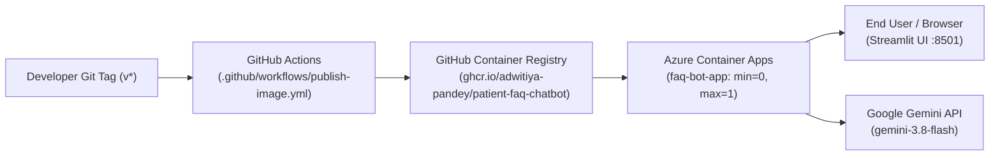

# Azure Container Apps Deployment Guide

This guide describes how to deploy the **Northfield Hospital Patient FAQ Chatbot** as a containerized web application on **Azure Container Apps (ACA)** with **scale-to-zero** configuration to guarantee **$0.00 idle operating costs**.

---

## 1. Architecture Overview

The container lifecycle is automated via GitHub Actions and Azure Container Apps:



### Key Architectural Decisions
- **Multi-Stage Container Image:** Based on official Python 3.13 slim image with Astral `uv` package manager, unprivileged non-root user `appuser` (uid 999), and built-in Python urllib healthcheck probe at `/_stcore/health`.
- **Serverless Scale-to-Zero:** `--min-replicas 0` ensures the container automatically terminates when idle. No vCPU or memory is allocated or billed when traffic ceases.
- **Zero Log Ingestion Cost:** Environment created with `--logs-destination none` to bypass Azure Log Analytics workspace ingestion fees entirely.
- **Secret Isolation:** `GEMINI_API_KEY` is injected as a managed secret reference (`secretref:gemini-key`), preventing credentials from appearing in container definitions, command history, or process listings.

---

## 2. Cost Model & Azure Free Tier Facts

The deployment is architected to operate comfortably within Azure and Google free grants:

| Component | Free Monthly Grant (Azure / Google) | Configured Setting | Estimated Monthly Cost |
|---|---|---|---|
| **Azure Container Apps vCPU** | 180,000 vCPU-seconds / month | 0.5 vCPU, active only during request processing | **$0.00** |
| **Azure Container Apps Memory** | 360,000 GiB-seconds / month | 1.0 GiB, active only during request processing | **$0.00** |
| **Azure Container Apps Requests** | 2,000,000 HTTP requests / month | Minimal portfolio evaluation traffic | **$0.00** |
| **Azure Log Analytics** | Typically 5 GB/month (if enabled) | Disabled via `--logs-destination none` | **$0.00** |
| **Google Gemini API** | Free tier (up to model daily quota) | Free tier evaluation key | **$0.00** |
| **Total Estimated Idle Cost** | — | — | **$0.00 / month** |

> [!NOTE]
> **Azure Free Account Credit:** New Azure accounts receive **$200 USD in free credits for the first 30 days**, followed by 12 months of popular free services and always-free grants (including Container Apps free tier).

---

## 3. Prerequisites

Before running the deployment scripts, ensure you have:
1. **Azure CLI (`az`)**: Version 2.50+ installed ([Install Azure CLI](https://learn.microsoft.com/cli/azure/install-azure-cli)).
2. **GitHub Container Registry (GHCR) Package Visibility**:
   - The first workflow run will push the container image to GHCR.
   - Go to: `https://github.com/adwitiya-pandey?tab=packages` -> Click `patient-faq-chatbot` -> **Package settings** -> Under **Danger Zone**, click **Change package visibility** -> Select **Public**.
   - Setting visibility to **Public** allows Azure Container Apps to pull the image without requiring registry credentials or personal access tokens.
3. **Google Gemini API Key**: A valid key for `gemini-3.8-flash` from [Google AI Studio](https://aistudio.google.com/).

---

## 4. Step-by-Step Deployment Walkthrough

Run the following commands in sequence from the repository root:

### Step 4.1: Authenticate with Azure CLI
```bash
az login --use-device-code
```
Verify that the active subscription is the one you intend to use:
```bash
az account show --output table
```
*(If you have multiple subscriptions, switch using: `az account set --subscription "<subscription-id-or-name>"`)*.

### Step 4.2: Set Gemini API Key
Export your Gemini API key in your current shell session (or ensure it is present in the local `.env` file):
```bash
export GEMINI_API_KEY="AIzaSy..."
```

### Step 4.3: Deploy to Azure Container Apps
Run the automated deployment script:
```bash
./scripts/azure/deploy.sh
```
*What this script does:*
1. Registers `Microsoft.App` and `Microsoft.OperationalInsights` resource providers if needed.
2. Creates resource group `faq-bot-rg` in region `centralindia` (configurable via `RG` and `LOCATION` env vars).
3. Creates a Container Apps environment with `--logs-destination none` (zero ingestion fees).
4. Creates/updates Container App `faq-bot-app` with:
   - Image: `ghcr.io/adwitiya-pandey/patient-faq-chatbot:latest`
   - Replicas: `--min-replicas 0 --max-replicas 1`
   - Resources: `--cpu 0.5 --memory 1.0Gi`
   - Secret reference: `GEMINI_API_KEY=secretref:gemini-key`
5. Outputs the live Application URL and healthcheck URL.

### Step 4.4: Verify Deployment with Remote Smoke Test
Run the remote smoke test script against your deployed application URL:
```bash
python3 scripts/smoke_remote.py https://<your-app-fqdn>.centralindia.azurecontainerapps.io
```
*What this script does:*
- Repeatedly polls `/_stcore/health` for up to 90 seconds, absorbing cold start latency.
- Validates that HTTP 200 and `"ok"` are returned.
- Validates that the root page `/` returns HTTP 200.

### Step 4.5: Configure $5 Budget Alert
Run the budget setup script to enforce cost protection:
```bash
./scripts/azure/budget.sh
```
*What this script does:*
- Creates a strict **$5.00 USD monthly budget** on `faq-bot-rg`.
- Configures automated email alert notifications at:
  - **50% threshold ($2.50 USD)**
  - **90% threshold ($4.50 USD)**
- If your Azure subscription type does not permit CLI budget creation (e.g. Free Trial or sponsorship), it displays exact 60-second steps to configure it in the Azure Portal.

---

## 5. Cold Starts & Runtime Behavior

When deployed with `--min-replicas 0`:
- **Cold Start (Scale from Zero):** When no user has visited the bot in 5+ minutes, the replica count is 0. The first incoming HTTP request wakes the container. In local testing, container startup takes **~2.0 seconds**; on Azure infrastructure, allocating and spinning up a serverless replica typically takes **15 to 30 seconds**.
- **Warm Requests:** Subsequent messages during an active session respond in **<1 second**.
- **Data Privacy Notice:** Queries handled via Google's free Gemini API tier may be used by Google to improve products. Only synthetic patient inquiries should be used for testing; never enter real protected health information (PHI).

---

## 6. Teardown & Clean-up

When testing or evaluation is complete, remove all cloud resources immediately:

```bash
./scripts/azure/teardown.sh
```
This script prompts for confirmation and executes:
```bash
az group delete --name faq-bot-rg --yes --no-wait
```
Deleting the resource group removes the container app, container environment, and all associated metadata, ensuring zero ongoing cloud footprint or billing.

---

## 7. Troubleshooting

| Symptom | Cause | Solution |
|---|---|---|
| `ImagePullBackOff` / `Failed to pull image` | GHCR package is still set to Private | Navigate to GitHub Profile -> Packages -> `patient-faq-chatbot` -> Package settings -> Change visibility to **Public**. |
| Remote smoke test timeout (>90s) | Cold start took longer or regional capacity delay | Rerun `python3 scripts/smoke_remote.py <url> --timeout 120`. Check container logs in Azure Portal -> Container App -> Log stream. |
| Model returns fallback: *"Our front desk team is currently assisting..."* | Free tier daily Gemini API quota reached (20 calls/day for 3.8-flash) | Expected behavior when rate limit is hit. The bot gracefully preserves user experience and protects against crashes. Resets at UTC midnight. |
| `SubscriptionNotRegisteredForFreeBudget` | Azure Free Trial / Sponsorship CLI budget restriction | Follow the manual portal instructions printed by `scripts/azure/budget.sh` under Cost Management -> Budgets. |
| `The subscription is not registered to use namespace 'Microsoft.App'` | Azure subscription needs resource provider registration | Run `az provider register --namespace Microsoft.App --wait` and retry deployment. |
